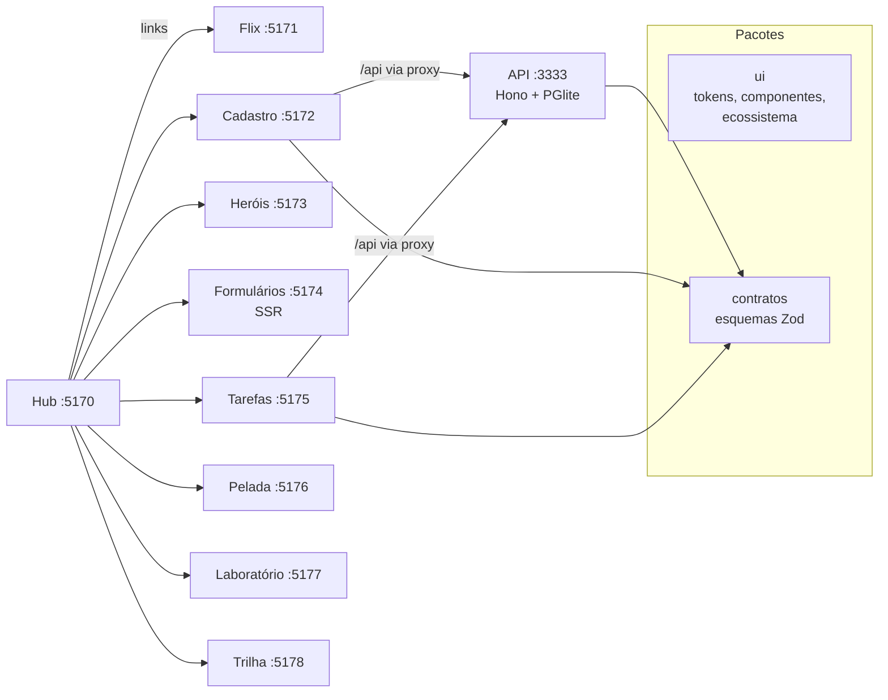

# 01 · Estado atual do projeto

_Levantamento feito em 24/10/2026, na branch `feature/spa-models` (conteúdo idêntico ao da `main`)._

## Visão geral

Monorepo pnpm com um **hub** (projeto 0) que apresenta **8 projetos filhos** com demonstrações ao vivo, uma **API compartilhada** e **3 pacotes comuns**. Sete filhos são ideias antigas reconstruídas com React moderno; o oitavo é uma trilha de estudo.

## Inventário

| # | Projeto | Pasta | O que faz | Stack de destaque | Arquivos de teste | Usa a API |
| --- | --- | --- | --- | --- | --- | --- |
| 0 | Hub | `apps/hub` | Página única com as 8 seções e demos com dados reais | React 19, MDX, Motion | 1 | Não |
| 1 | Flix | `1-flix` | Catálogo de vídeos | TanStack Query, React Router | 4 | Não |
| 2 | Cadastro | `apps/cadastro` | CRUD de clientes, repositório em memória ou API | TanStack Query, React Hook Form, Zod | 2 | Sim (modo API) |
| 3 | Portal de Heróis | `apps/herois` | Catálogo, fichas, equipes e comparação | Tailwind v4, Motion | 2 | Não |
| 4 | Formulários no Servidor | `apps/formularios` | Formulários que funcionam sem JavaScript | React Router modo framework (SSR) | 3 (inclui Playwright) | Não |
| 5 | Tarefas | `apps/tarefas` | Atalhos, busca por regex, conclusão otimista | Redux Toolkit, RTK Query | 2 | Sim |
| 6 | Lista da Pelada | `apps/pelada` | Vagas, lista de espera, sorteio equilibrado | Hooks puros, reducer | 3 | Não |
| 7 | Laboratório | `apps/laboratorio` | 17 lições em MDX com demo, código e teste | MDX | 18 | Não |
| 8 | Trilha React | `apps/trilha` | 116 aprendizados em 12 módulos | Estado na URL, `useSyncExternalStore` | 3 | Não |
| — | API | `apps/api` | Clientes e tarefas | Hono, Drizzle, PGlite | 1 | — |
| — | UI | `packages/ui` | Componentes, hooks, tokens e mapa do ecossistema | React | 3 | — |
| — | Contratos | `packages/contratos` | Esquemas Zod compartilhados entre front e API | Zod | 1 | — |
| — | Config | `packages/config` | TypeScript base | — | 0 | — |

**Totais:** cerca de 456 arquivos de código e configuração; 43 arquivos de teste.

## Arquitetura atual

### Decisões já presentes no código

| Decisão | Onde está |
| --- | --- |
| **Fonte única de endereços** entre hub, filhos e API | `packages/ui/src/utilitarios/ecossistema.ts` |
| **Em desenvolvimento**, cada projeto roda na própria porta (5170 a 5178) | `ecossistema.ts` e `vite.config.ts` de cada app |
| **Publicado**, cada filho fica numa pasta do mesmo domínio (`/flix/`, `/tarefas/`…) | `base` nos `vite.config.ts`; `basename={import.meta.env.BASE_URL}` nos roteadores |
| **API sempre em `/api`** no mesmo domínio, sem CORS no navegador | `enderecoDaApi()` e `proxyDaApi()` |
| **Formulários com SSR** sob `/formularios/` também em desenvolvimento | `react-router.config.ts` |
| **Catálogo único de versões** e `engineStrict` | `pnpm-workspace.yaml` |
| **Regras de negócio em funções puras**, validadas com Zod e testadas sem tela | Padrão de todos os filhos |
| **Banco PGlite** (Postgres em WebAssembly) gravado em `apps/api/.dados` | `apps/api/src/config.ts` |

### Navegação entre projetos

| Origem | Destino | Implementação |
| --- | --- | --- |
| Hub → filho | `enderecoDoProjeto(n)` | `apps/hub/src/dados/projetos.ts` |
| Filho → hub | `enderecoDoHub(n)` (âncora `#filho-n`) | `config.ts` de cada filho; o Flix monta o endereço à mão |
| Trilha e Laboratório → outros filhos | `enderecoDoProjeto(n, caminho)` | `apps/trilha/src/paginas/*`, `apps/laboratorio/src/config.ts` |

Em desenvolvimento, **um link só funciona se o projeto de destino estiver rodando**. Para todos os links funcionarem, use `pnpm dev:tudo`.

## Qualidade

| Verificação | Resultado |
| --- | --- |
| `pnpm verificar` (lint, tipos, testes, build) | ✅ Passa |
| Dependências desatualizadas | Apenas correções (ex.: Vite 8.3.1 → 8.3.5, React 19.3.0 → 19.3.1) |
| Vulnerabilidades (`pnpm audit`) | 15 (5 altas, 9 moderadas, 1 baixa); as visíveis vêm de ferramentas de desenvolvimento e teste (`vite`, `undici` via `jsdom`) |
| CI | ❌ Nenhum workflow |
| Configuração de publicação | ❌ Nenhuma |

## Ambiente de desenvolvimento

| Requisito | Valor |
| --- | --- |
| Node | **24.15.0 ou superior** na linha 24 (ou 22.22.2 na linha 22). O `engines` da raiz ainda diz 22.12.0 (ver ajuste A-01) |
| pnpm | 10.28.0 |
| Banco | Não precisa instalar: o PGlite roda dentro da API |

## Riscos conhecidos

| Risco | Impacto |
| --- | --- |
| Não existe servidor de produção que junte estáticos, API e SSR | O projeto não pode ser publicado como foi projetado |
| Sem teste de navegação entre projetos | Links quebrados só aparecem manualmente |
| Sem CI | Regressões passam despercebidas |
| Requisito de Node incorreto | Instalação falha em Node 24 abaixo de 24.15 |
| Banco em disco local | Em hospedagem com disco temporário, os dados voltam ao exemplo a cada reinício |
| API lê a porta em `PORTA` | Provedores de hospedagem informam a porta em `PORT` |
