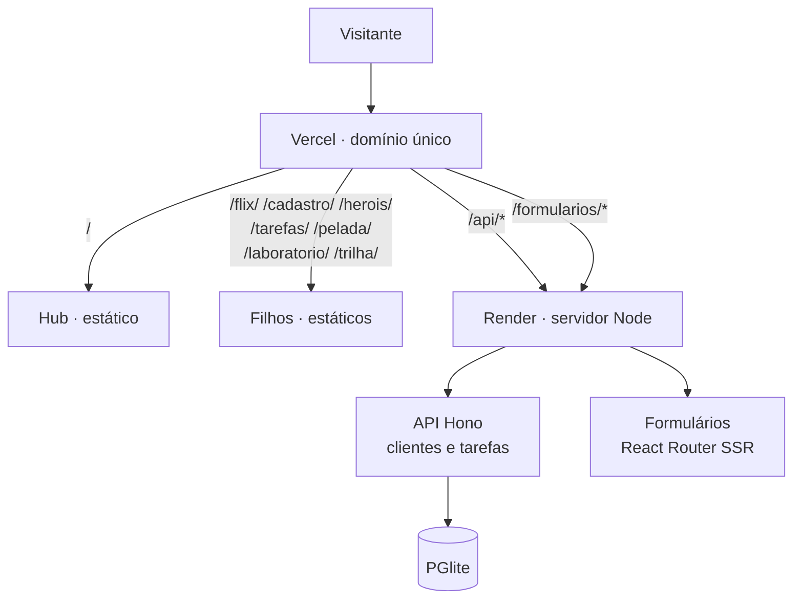

# 02 · Plano de arquitetura do MVP

## Objetivo

Publicar o hub, os 8 filhos e a API **sob um único domínio**, mantendo as decisões que já estão no código (pastas por projeto e API em `/api`) e garantindo que todo link funcione publicado.

## Arquitetura-alvo

| Camada | Onde roda | Conteúdo |
| --- | --- | --- |
| Estáticos | Vercel | Hub na raiz e 7 filhos em pastas próprias |
| Dinâmico | Render | Um único servidor Node com a API em `/api` e o SSR em `/formularios/` |
| Roteamento | Vercel (`vercel.json`) | Encaminha `/api` e `/formularios` ao Render; garante que rotas internas dos filhos carreguem o app |

## Componentes novos

### `apps/servidor` (servidor de produção)

| Responsabilidade | Como |
| --- | --- |
| Expor a API em `/api` | Monta o `criarApp` de `@components/api` sob o prefixo `/api` |
| Expor o SSR do Formulários em `/formularios/` | Usa o build do React Router (`build/server`) e entrega `build/client` como arquivos estáticos |
| Ler a porta do provedor | `PORT`, com `PORTA` e 3333 como alternativas |
| Saúde | `GET /api/saude` |
| **Ensaio de produção local** | Com `pnpm ensaio:producao` (opção `--ensaio`, ou a variável `SERVIR_ESTATICOS=1`), também entrega a pasta `publicar/` (hub e filhos), reproduzindo no computador o site publicado num único endereço |
| Estrutura | `src/app.ts` compõe as partes e é testado com Vitest; `src/servidor.ts` abre o banco, carrega o build e escuta na porta |

Princípio: **reaproveitar, não reescrever**. O servidor só compõe peças que já existem e já são testadas.

O modo de ensaio também serve de alternativa de hospedagem: um único serviço Node entregando tudo (ver [ADR 0003](adr/0003-hospedagem-vercel-render.md)).

### `scripts/montar-publicacao.mjs`

Depois do `pnpm build`, monta a pasta `publicar/`:

| Origem | Destino |
| --- | --- |
| `apps/hub/dist` | `publicar/` |
| `1-flix/dist` | `publicar/flix/` |
| `apps/<slug>/dist` | `publicar/<slug>/` (cadastro, herois, tarefas, pelada, laboratorio, trilha) |

O Formulários não entra na pasta: ele é servido pelo `apps/servidor` (SSR).

### `vercel.json`

Configura build, pasta de saída e regras de encaminhamento (detalhes em [04 · Hospedagem](04-hospedagem.md)).

## Ajustes de arquitetura

| Ajuste | Motivo |
| --- | --- |
| Mover `1-flix` para `apps/flix` | Único projeto fora do padrão |
| Flix usar `enderecoDoHub(1)` | Hoje monta o endereço à mão, fora da fonte única |
| `strictPort: true` no hub | Se a 5170 estiver ocupada, os botões de voltar quebram |
| API ler `PORT` | Padrão dos provedores de hospedagem |
| Origens do CORS por variável de ambiente em produção | Hoje o padrão lista só portas de desenvolvimento |
| Carregamento sob demanda no hub | 685 kB de JavaScript inicial |
| Fontes só com alfabeto latino | Cirílico, grego e vietnamita não são usados |

## Dados

| Ambiente | Banco | Comportamento |
| --- | --- | --- |
| Desenvolvimento | PGlite em `apps/api/.dados` | Persiste entre execuções |
| Testes | PGlite em memória | Reiniciado entre testes |
| Publicado (Render gratuito) | PGlite em disco temporário | **Volta aos dados de exemplo** a cada reinício. Aceitável para demonstração de portfólio |
| Futuro (se precisar persistir) | Postgres gerenciado | Troca facilitada pelo Drizzle |

## Decisões registradas

| ADR | Decisão |
| --- | --- |
| [0001](adr/0001-pnpm-monorepo.md) | pnpm e monorepo |
| [0002](adr/0002-um-dominio-com-pastas.md) | Um domínio, uma pasta por projeto, API em `/api` |
| [0003](adr/0003-hospedagem-vercel-render.md) | Hospedagem: Vercel para estáticos, Render para o dinâmico |
