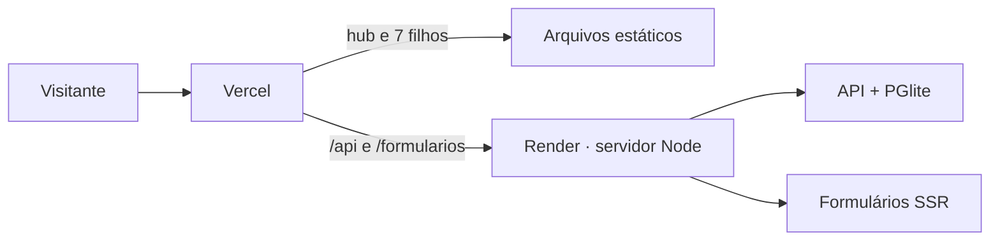

# components

Portfólio de engenharia front-end em React: um **hub** que apresenta **8 projetos**, cada um com uma demonstração ao vivo feita com os dados e as regras reais do projeto. Sete são ideias antigas reconstruídas do zero com React moderno; o oitavo é uma trilha de estudo com 116 aprendizados. Cada projeto usa uma stack diferente, de propósito, para mostrar abordagens distintas para problemas comuns de interface.

**Site:** https://components-dusky-nine.vercel.app

## Projetos

| # | Projeto | O que faz | Destaque técnico |
| --- | --- | --- | --- |
| 0 | Hub | Apresenta os filhos com demos ao vivo | React 19, MDX |
| 1 | Flix | Catálogo de vídeos | TanStack Query |
| 2 | Cadastro | CRUD de clientes com repositório trocável (memória ou API) | TanStack Query, React Hook Form, Zod |
| 3 | Portal de Heróis | Universo original com equipes, fichas e comparação | Tailwind v4, Motion |
| 4 | Formulários no Servidor | Formulários que funcionam sem JavaScript | React Router em modo framework (SSR) |
| 5 | Tarefas | Atalhos de teclado, busca por regex e conclusão otimista | Redux Toolkit, RTK Query |
| 6 | Lista da Pelada | Vagas, lista de espera e sorteio equilibrado de times | Hooks puros, reducer |
| 7 | Laboratório | 17 lições em MDX com demo, código e teste | MDX, React 19 |
| 8 | Trilha React | 116 aprendizados em 12 módulos e o mapa da stack | Estado na URL, `useSyncExternalStore` |
| — | API | Clientes (02) e tarefas (05) | Hono, Drizzle, PGlite |

Cada projeto tem o próprio README, com telas, regras de negócio numeradas, estrutura e stack.

## Como funciona

O repositório é um **monorepo pnpm**: cada projeto é uma aplicação independente, mas todos compartilham uma única instalação, um catálogo de versões e dois pacotes comuns, `@components/ui` (identidade visual e mapa de endereços) e `@components/contratos` (esquemas Zod usados pelo front e pela API).

Publicado, tudo fica **sob um único domínio**: o hub na raiz e cada filho na sua pasta (`/flix/`, `/trilha/`…). As partes estáticas são servidas pela **Vercel**; a API e o Formulários, que precisam de servidor, rodam num único processo Node no **Render**, e a Vercel repassa `/api` e `/formularios` para ele.



## Engenharia

- **Qualidade verificável:** TypeScript estrito, lint, testes e build em todos os projetos com um único comando (`pnpm verificar`).
- **Testes em camadas:** regras de negócio em funções puras testadas com Vitest; telas com Testing Library e axe; API com banco real em memória; navegação entre projetos com Playwright.
- **Integração contínua:** GitHub Actions roda a verificação e os testes de navegador em todo push e pull request.
- **Fonte única de endereços:** links entre projetos saem de um mapa só, que também serve de gabarito para os testes.
- **Produção reproduzível:** um ensaio local entrega o site exatamente como publicado, antes de cada deploy.
- **Decisões registradas:** cada escolha de arquitetura tem um ADR com contexto, alternativas e consequências.

**Situação:** a parte estática está publicada; a parte dinâmica (API e Formulários) está em publicação. O que falta para o MVP estável e os passos seguintes estão em [docs/06 · Próximos passos](docs/06-proximos-passos.md).

## Começar

Requisitos: Node 24.15 ou mais novo na linha 24 (a versão do projeto está em `.node-version`) e pnpm 10.28.

```bash
pnpm install
pnpm dev:tudo        # hub, os 8 filhos e a API
pnpm verificar       # lint, tipos, testes e build
pnpm test:navegacao  # navegação entre projetos (Playwright)
```

Comandos por projeto, portas e o ensaio de produção estão em [docs/02 · Arquitetura](docs/02-plano-de-arquitetura.md).

## Documentação

| Para saber | Leia |
| --- | --- |
| Situação atual, riscos e evolução desde o início | [01 · Estado atual](docs/01-estado-atual.md) |
| Arquitetura, ambientes e caminho das requisições | [02 · Arquitetura](docs/02-plano-de-arquitetura.md) |
| Estratégia e situação dos testes | [03 · Plano de testes](docs/03-plano-de-testes.md) |
| Como publicar, validar e diagnosticar | [04 · Hospedagem](docs/04-hospedagem.md) |
| Ajustes, prioridades e histórico | [05 · Ajustes e backlog](docs/05-ajustes-e-backlog.md) |
| O que vem a seguir | [06 · Próximos passos](docs/06-proximos-passos.md) |
| Por que as coisas são como são | [ADRs](docs/adr/) |

## Estrutura

```
components/
├── apps/          hub, 7 filhos, API e servidor de produção
├── 1-flix/        projeto 01
├── packages/      ui, contratos, config e testes de ponta a ponta
├── scripts/       montagem do site publicado
├── docs/          documentação técnica e ADRs
└── vercel.json    publicação na Vercel
```

## Padrões comuns

- Uma instalação só (pnpm workspaces) e um catálogo de versões para todos.
- TypeScript estrito, CSS Modules (Tailwind só no 03) e os tokens de `@components/ui`.
- Regras de negócio em funções puras, validadas com Zod e testadas sem tela.
- Estado derivado sempre que possível; filtros e abas na URL quando fazem sentido.
- Comentário só no início e no fim de cada arquivo e no início de cada função.
